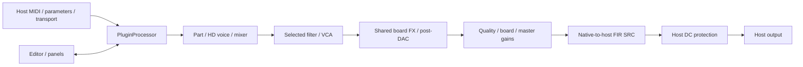

# SWARA XT architecture

SWARA XT adapts the Shruthi voice and control model to a JUCE processor, with
native-rate synthesis, selectable filter paths and host-rate output conversion.

## Processing pipeline

`Source/Plugin/PluginProcessor.*` owns APVTS, `ParameterCache`, `SequenceState`,
`SwaraXtEngine`, preset metadata and host serialization. It captures host
transport and passes an admitted control cohort, MIDI and output buffer to the engine.

The native clock is `20,000,000 / 510` Hz, approximately 39.216 kHz. Firmware
transactions contain 40 native samples; a host callback may consume part of a
transaction or several transactions. The engine schedules MIDI and transport
against this timeline and converts native output to the host rate. Host rates
accepted by `supportsHostSampleRate()` are 8–384 kHz.

`PatchBridge` translates cached public parameters into firmware patch/system
fields, including the public 0–127 to firmware 0–63 Sub/Noise mixer conversion.
Production uses the adapted `avrlib_hd` voice facade in
`Source/Engine/ShruthiPort`: two oscillator sources, mixer, sub/noise,
envelopes, LFOs and modulation. The classic oscillator implementation remains
a parity oracle rather than a selectable production renderer. Dedicated
filter ENV/LFO fields coexist with the twelve-slot modulation matrix.

## Selected filter paths

Classic uses `SwaraXtFilter::processInstrumentSample()`, `FilterRateConverter`
and `Ir3109BoardCore`, including CV reconstruction, nonlinear poles, coupling,
VCA and converter history. High, Normal and Eco select its processing quality.
Firmware cutoff/resonance and the Classic key-tracking trim feed this path.

`ShruthiSvfDual` provides Section 1, Serial and Parallel routing with LP/BP/HP
taps and Paper/Eagle calibration. Section 2 supports shared Follow controls,
Independent cutoff/resonance, or Relative cutoff with independent resonance.
Its CV reconstruction uses the firmware patch/modulation semantics. Parallel
retains its summing law; no per-routing loudness normalization is applied.

A packed atomic `ExperimentalSvfSelection` publishes manual requests. These
controls are outside APVTS automation and musical state serialization. Exactly
one filter processes each native sample. Active bank selection follows
`Stable -> FadeOut -> MutedPreparation -> FadeIn -> Stable`: 157 native samples
out, transaction-boundary resolution and full incoming reset, 512 samples of
muted real-input preparation, then 157 samples in. Boundary alignment adds a
variable wait. Reversal before reset recovers the outgoing bank; later requests
coalesce until the admitted operation completes. Genuine dormant switching
uses the audio-owned control path without the active fade/preparation interval.

The bank envelope acts before shared FX. Incoming Classic resets converter,
board and VCA history; incoming Dual resets its core and compensation FIFO.
Routing, tap and calibration edits retain their existing single-object update
semantics; they are distinct from the Classic/Dual bank envelope.

Classic quality transitions retain the 78-native-sample out/in phases. Quality
ownership is resolved before admitting a bank change, and incoming Classic
quality is settled before reset/preparation. Stable Dual does not run inactive
Classic quality fades.

## Shared output, latency and dormancy

The selected post-VCA signal feeds one `BoardProcessor`. `BoardEffects`
implements sixteen programs plus Off: distortion, crush, comb, ring modulation,
delay variants, looper and pitch processing. Post-DAC coloration and existing
quality/board/master gains precede `PolyphaseFirResampler` and host DC blocking.
Bank switching preserves the shared effects and output-conversion histories.

Classic converter latency is 256 native samples. Dual's `DualOutputDelay`
supplies the same 256-sample compensation; common host SRC contributes 128.
The fixed total is 384 native samples, or 9.792 ms, reported as the ceiling of
its host-sample equivalent. Filter response phase and manual switch response
time are separate from this pipeline latency.

Dormancy combines voice/modulation/clock conditions, selected-filter output,
effect tails and SRC/DC drainage. Dual requires exact VCA closure, an exhausted
FIFO and a valid envelope/modulation silence proof. FX terminal output is
checked as well as its tail flag. Active switching prevents sleep; control
edits that invalidate silence can wake processing. Queued SRC output drains
before native rendering resumes when more input is needed.

## Control admission, sequencing and MIDI

`processBlock()` makes one non-waiting `stateUpdateGate_` admission attempt and
holds successful admission through engine rendering. A busy gate retains the
previous working control cohort, including tuning. State writers acquire the
publication lock before waiting for this gate; the callback takes no control-side mutex.

`SequenceState::capture()` similarly makes one `atomic_flag` attempt, copies
the fixed sixteen-step payload with revisioned writers excluded, then releases.
Revision is bookkeeping, not a seqlock consistency proof. Failed audio capture
retains the previous sequence; independent arpeggiator pattern automation uses
its separate atomic scalar. Control-side writers may wait.

`Part` owns sequencer/arpeggiator playback and clocks. LEGACY uses integer
notes, LINEAR continuous CV, SCALE signed tuning degrees, and QUANTIZED CV
quantizes continuous pitch without rewriting stored CV. Randomization operates
on the relevant pitch representation and step attributes. The admitted INPUT
TUNE mode reaches `Part` before same-callback MIDI dispatch.

MIDI output uses fixed-capacity scheduling and explicit note/channel ownership.
Failed release admission retains a bounded retry obligation; transport and
release/reprepare paths request cleanup. Delivery still requires host processing
callbacks. LEGACY and QUANTIZED CV emit MIDI notes, the latter rounded to the
nearest 12-TET note; LINEAR and SCALE stay internal.

GUI notifications are separate from sequence snapshots. The independently
owned listener hub coalesces `pending`/`armed` with sequentially consistent
handshake operations, schedules message-thread delivery and serializes listener
removal with delivery. Queued callbacks own the hub rather than `SequenceState*`.

## Tuning and import

`cmake/BuiltinTunings.cmake` is the ordered 37-entry factory catalog.
`EmbedBuiltinTunings.cmake` converts SCL sources to embedded SWT data at build
time; the original six indices are preserved. SCALE, QUANTIZED CV and INPUT
TUNE share one active tuning and quantizer, including non-octave periods.

`PluginProcessor::importTuningFile()` reads and validates on a control thread,
with a 256 KiB limit per file. Standard SCL import interprets integer pitches
as ratios and decimal pitches as cents. Optional, explicitly selected KBM data
provides repeated mapping patterns, middle/reference anchoring, formal period
and unmapped keys. Existing SWT import remains available. Legacy Scala parsing
is retained for compatible build-time conversions. Engine publication supports
up to 256 interior pitches plus the period; keyboard mapping and voice range
remain constraints. Conversion/publication failure preserves the active tuning.

`PublishedTuning` is fixed-capacity audio data. Three engine-lifetime slots
separate publication, audio latching, retirement and control-side query claims.
Writer admission and slot protection prevent reuse while readers hold a slot.
The callback copies an adopted table into stable audio-owned storage used by
`Part`. Serialized tuning bytes have separate control-side synchronization;
the callback does not parse files or own their lifetime.

## Presets and state

State schema 3 contains APVTS parameters, sequence/workflow metadata, Classic
quality, preset identity and embedded tuning bytes. Factory programs comprise
11 native programs, 40 imported 92-byte Shruthi patches and six authored APVTS
records. User presets use the processor state format. Sequence Lock preserves
sequence-related parameters, steps and tuning during preset loading.

`StateWriterScope` serializes writers. Restore validates and stages incoming
data, reserves tuning publication before mutation, then applies APVTS,
sequence, quality and metadata under `BulkPublicationScope`. Recoverable
validation/admission failures reject before mutation. Replacement-time
parameter listeners must not throw; listener side effects are not rolled back.
The void host restore API records its result internally. Legacy handling and
checked fallback decisions live in `restoreState()`.

An odd bulk-publication epoch makes reentrant saves return the committed
pre-transaction blob and metadata. Completed saves serialize accepted live
state. User-preset writes use same-directory temporary files with checked
publication; metadata completion is generation-checked. Serialization and
filesystem operations belong off the audio thread.

Dual selection/configuration remains instance-local: editor recreation and
preset loading retain the current choice, while a fresh processor starts with
Classic. Opening an editor reconstructs controls from the processor state.

## Interface

`PluginEditor` and `Source/Ui` compose oscillator, LFO, Mixer/filter, envelope,
Global/FX and Seq/Arp areas with local views. The matrix stays in Mixer with
twelve routes, three visible rows and four pages; slot 12 retains Mod Wheel
scaling. Dual routing/mode/calibration controls occupy the front-panel details
view, rather than duplicate right-click entries.

Five skins, three sizes, colours, SVG artwork, decorations and manufacturer
marks use local UI preferences, separate from musical parameters. The right-click
menu exposes MIDI channel, Classic quality and interface customization.
`SwaraXtSkinEditor` is a separate palette preview/edit/save/load utility.

## Platform builds and real-time boundaries

CMake 3.22+ and C++17 build VST3 and optional Standalone; Apple builds also add
AU. Skin Editor and test targets have separate build options. Windows/macOS use
JUCE 9.0.1 at `e18f7f506c0b96f2c738a0bcd7fe6467a5005ad8`; the Linux
engineering configuration uses JUCE 9.0.4 at
`3fb5cbc0340758596dac39f7c8de47d562b4896e`. Linux validates the pristine
input and generates its compatibility sources in the build tree. Dependencies
and release/development presets are described in [BUILDING.md](../BUILDING.md).

Steady audio work uses fixed storage and bounded operations. Parsing,
serialization, file I/O and control-thread waits are outside that contract.
Native 40-sample bursts and bounded reset/recovery costs still require measurement
against host deadlines. Regression coverage spans voice/parity, production filters,
latency/SRC, modulation/MIDI, sequencer, tuning/import, state publication,
dormancy and GUI lifecycle. Native validation and sanitizer configurations are
opt-in engineering checks, separate from ordinary product builds.
