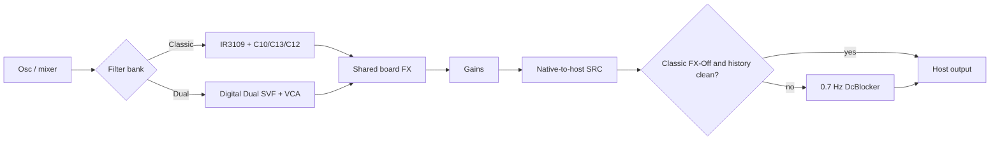

# FX-Off host DC blocker audit

**Branch:** `investigation/fx-off-dc-blocker`  
**Baseline SHA:** `bd8811323640627babeec5d8bc256b2bf2b35110`  
**Phase I (superseded methodology):** `cb6198c`  
**Phase II engine bypass:** `82cda90`  
**Measurement validation:** [`FX_OFF_DC_MEASUREMENT_VALIDATION.md`](FX_OFF_DC_MEASUREMENT_VALIDATION.md)

## Final engineering decision

| Path | Persistent DC (corrected) | Host 0.7 Hz blocker |
| --- | --- | --- |
| **Classic FX-Off** | Worst sustain cumulative mean **−85.9 dBFS** | **Bypass** after SRC/FX history flush |
| **Dual SVF FX-Off** | Stable **≈ −33.7 dBFS** | **Retain** |
| **Any FX-On / residual FX** | Distortion ≈ **−26 dBFS** pre-blocker | **Retain** |

Phase I’s conclusion that Classic also required the host pole was based on flawed finite-window means (incomplete sub-oscillator periods and coupling transients). Phase II disproved that Classic result and confirmed Dual/FX necessity.

## Toolchain

| Item | Value |
| --- | --- |
| Host | Windows 10 x64 |
| CMake | 4.2.0-rc2 / VS 2022 |
| JUCE | 9.0.1 @ `e18f7f506c0b96f2c738a0bcd7fe6467a5005ad8` |
| Build | `Z:/SWARAXT-DC-AUDIT-builds/win-release` |
| Artifacts | `Z:/SWARAXT-DC-AUDIT-builds/phase2/` |

## Architecture

Classic already provides schematic AC coupling (~0.339 / 7.87 / 1.026 Hz). Dual does not. Software-only host `DcBlocker` (0.7 Hz) remains the Dual/FX safety net.

## Production change

Smallest maintainable bypass in `SwaraXtEngine::process`:

- Arm `hostDcProtectionRemaining_` whenever Dual is selected, FX ≠ Off, or `boardRequiresAudio()`.
- Count down only on a clean Classic FX-Off path.
- Bypass `DcBlocker::process` only when that counter is zero and no emergency/DC-drain path is active.
- Reset blocker state on engage/disengage to avoid stale filter memory.

Dual, FX-On, SRC contamination windows, panic drain and dormancy DC drainage keep protection.

## Measurement evidence

Harnesses:

- Phase II: `Tests/DcAudit/FxOffDcBlockerAuditPhase2Main.cpp` (`SWARAXT_ENABLE_DC_AUDIT_TAPS`)
- Capture reanalysis: `Z:/SWARAXT-DC-AUDIT-builds/phase2/reanalysis/`

| Case | Original Phase I DC | Corrected persistent DC | Artifact? | Origin | Verdict |
| --- | --- | --- | --- | --- | --- |
| Classic sub | −61.7 | −87.2 cmean (30 s) | Yes (Phase I) | Transient / period error | Bypass OK |
| Classic saw | −70 raw | −96.2 cmean | Yes | Period residue | Bypass OK |
| Classic noise | −77.4 quiet | −114.1 cmean | Mostly | Stochastic gate | Bypass OK |
| Dual saw | −33.7 | −33.7 stable | No | Dual LP mean | Keep blocker |
| Classic FX dist | −26.1 | −26.1 stable | No | FX integer path | Keep blocker |

With bypass enabled, Classic FX-Off `|pre−post|` cumulative means are ~1e−7…1e−5. Dual post remains attenuated (e.g. −33.7 → −77 dBFS).

## Transition correctness

Bypass is not `if (fxOff) skip`. It requires:

1. Classic bank (`!experimentalSvfEnabled_`)
2. `Effect::off`
3. `!boardRequiresAudio()`
4. Expired SRC/FX history guard
5. No emergency / dormancy DC-drain path

## Classic reference differential

The seven Classic audio-parity mismatches are the host 0.7 Hz stage.

- An unconditional-blocker build reproduces the historical hashes in `kClassicHostDcBlocked`.
- Replaying `y[n] = x[n] - x[n-1] + pole * y[n-1]` on the bypass render's pre-blocker samples reproduces those same hashes.
- The bypass prediction matches the rendered samples with no float mismatches. After the 11790-sample protection guard, the render is identical to the pre-blocker stream. Silence is unchanged.

`kClassic` now stores the bypass renders. The historical hashes remain.

## Remaining limitations

- Dual DC root cause beyond “no AC coupling / stable mean” not fully schematic-mapped.
- Full Cartesian oscillator × Dual × preset matrix not claimed.
- Full Windows Release/Debug CTest + pluginval suite should gate merge readiness.

## Recommendation

**Ship Classic FX-Off host-DC bypass; keep the 0.7 Hz blocker for Dual and all FX-active/residual paths.**  
Do not merge until remaining Windows qualification requested for this PR is green.
