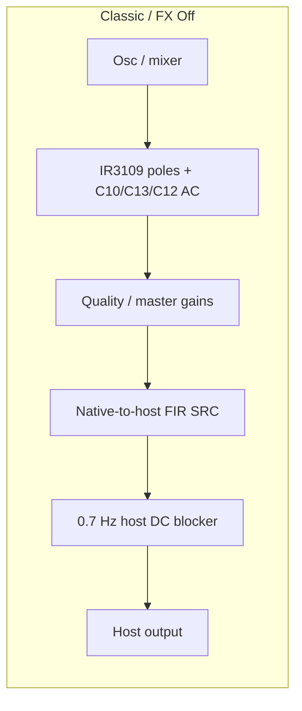
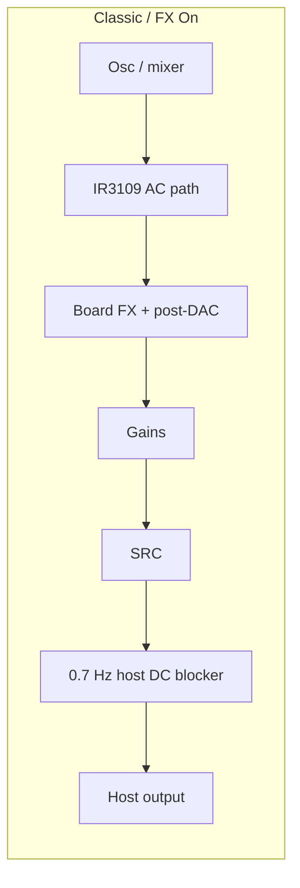
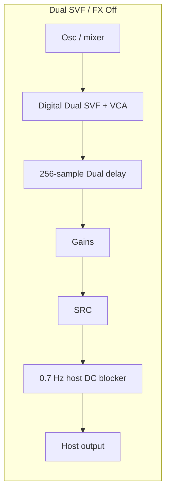
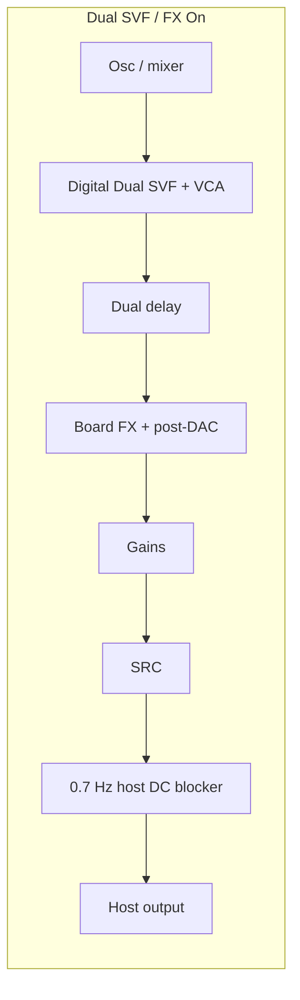

# FX-Off host DC blocker audit

**Branch:** `investigation/fx-off-dc-blocker`  
**Baseline SHA:** `bd8811323640627babeec5d8bc256b2bf2b35110`  
**Final engineering decision:** **Do not remove** the 0.7 Hz host-output DC blocker for Classic or Dual FX-Off paths.

## Toolchain

| Item | Value |
| --- | --- |
| Host | Windows 10 x64 |
| CMake | 4.2.0-rc2 |
| Generator | Visual Studio 17 2022 x64 |
| MSVC (configure) | 19.38.33145.0 / toolset 14.38.33130 |
| JUCE | 9.0.1 @ `e18f7f506c0b96f2c738a0bcd7fe6467a5005ad8` |
| Build tree | `Z:/SWARAXT-DC-AUDIT-builds/win-release` |
| Artifacts | `Z:/SWARAXT-DC-AUDIT-builds/dc-artifacts` (captures remain on Z:) |

## Hardware / software architecture

Mutable Instruments Shruthi IR3109 surrounding circuitry already provides schematic-derived AC coupling in the Classic path:

| Stage | Components | Approx. pole |
| --- | --- | --- |
| Input AC | C10/R7 (`Ir3109BoardCore::kInputTau`) | ~0.339 Hz |
| Shared filter-output AC | C13 (`kSharedOutputTau`) | ~7.87 Hz |
| Output AC | C12/R8 | ~1.026 Hz |
| Host safety HPF | `DcBlocker` in `HostResampler.*` | 0.7 Hz (software-only) |

Dual SVF (`ShruthiSvfDual`) is a digital SVF + prototype VCA path. It does **not** reproduce the IR3109 AC-coupling network.

Board FX integer/distortion/feedback paths can create new DC after the filter/VCA. `BoardOutputModel` explicitly relies on the final host blocker for LF safety rather than duplicating C10-class coupling.

### Signal flow

Software-only stages: Dual delay matching, board FX/post-DAC, quality/master gains, polyphase SRC, host `DcBlocker`, dormancy DC drainage / panic reset of blocker history.

## Measurement method

Harness: `Tests/DcAudit/FxOffDcBlockerAuditMain.cpp` (`SwaraXTFxOffDcBlockerAudit`).

1. Render through the production `SwaraXtAudioProcessor` / `SwaraXtEngine`.
2. Capture native post-FX/gain samples via existing `SWARAXT_ENABLE_SHRUTHI_DEBUG_TAPS` (`DebugBlockCapture::postVca`).
3. Independently replay `HostRateConverter` to obtain **pre-blocker** host samples.
4. Replay the same stream through `DcBlocker` and confirm bit-exact agreement with production host output (`host_vs_replay_max == 0` on all cases).
5. Decision metrics (avoiding period-residue false DC):
   - Integer-period sustain windows from MIDI note frequency.
   - Post-release quiet residual (`|y| < 1e-3` for ≥0.5 s after a 0.25 s settle skip).
6. Harness validation:
   - Known +0.25 DC rejected by blocker below −80 dBFS.
   - Integer-period 0.5 Hz sine not reported as DC.
   - Constant unit input through `Ir3109BoardCore` alone: **−194.3 dBFS**.

Raw captures (`.preDc.f32`) remain under `Z:/SWARAXT-DC-AUDIT-builds/dc-artifacts/captures/`. Compact CSV/JSON copies are committed beside this report.

## Coverage

Offline matrix: Classic and Dual × FX Off/On, saw/square/noise/sub corners, min/max cutoff and resonance, host rates 44.1 / 48 / 96 / 192 kHz, block sizes 16 / 64 / 512, Dual serial routing. Sustains ≈4 s and releases ≈2 s. Production binaries and DSP arithmetic were not modified for these observations.

## Results

| Path | Worst decision DC | Worst case | Assessment |
| --- | --- | --- | --- |
| Classic FX-Off | **−61.7 dBFS** | `classic_fxoff_sub` (integer-period) | Blocks removal (< −80 dBFS required) |
| Dual FX-Off | **−33.4 dBFS** | `dual_fxoff_maxres` / saw cases | Blocks removal |
| FX-On negative control | **−26.1 dBFS** pre-blocker | `classic_fxon_dist` | Blocker remains mandatory |

Additional Classic notes:

- Periodic saw/square integer-period sustains are typically **−115…−132 dBFS** with quiet residuals often below −80 dBFS: the IR3109 AC network is effective for those voices.
- `classic_fxoff_noise` quiet residual **−77.4 dBFS** (investigate band).
- `classic_fxoff_sub` remains above −80 dBFS even with integer-period analysis (**−61.7 dBFS**), so Classic cannot be blanket-qualified.
- Dual never entered a quiet residual window (`quiet_n = 0`): the persistent offset keeps `|y|` above the quiet threshold until the host blocker removes it.

Machine-readable summary: [`fx_off_dc_summary.json`](fx_off_dc_summary.json), full table: [`fx_off_dc_matrix.csv`](fx_off_dc_matrix.csv).

## Interpretation

1. The schematic Classic AC path is real and strong (constant-input board residual −194 dBFS; many musical FX-Off cases are already excellent before the host pole).
2. That strength is **not universal** across all FX-Off Classic configurations (sub-heavy and some noise residuals).
3. Dual FX-Off has large, stable pre-blocker DC (~−33 dBFS). Removing the host pole there would expose that offset.
4. FX-enabled paths (especially distortion) generate substantial pre-blocker DC; the existing 0.7 Hz stage is doing necessary work there.
5. Therefore the host blocker is not merely legacy redundancy: it remains the shared safety net for Dual, FX-On, and Classic edge cases.

## Transition / lifecycle

No production bypass was implemented. Existing dormancy drainage, panic `dcBlocker_.reset()`, and FX fade ownership stay unchanged. Any future Classic-only bypass would still need history-aware engagement while Dual/FX paths remain protected; that work is out of scope while qualification fails.

## Fidelity / CPU

Null-test differences from removing the 0.7 Hz pole were not pursued as a production change. Expected transfer-function difference is a single high-pass; measured pre-blocker Dual/FX DC shows the safety cost of removing it. No production CPU path changed.

## Remaining limitations

- Matrix is adversarial and multi-rate, but not an exhaustive Cartesian product of every oscillator algorithm × Dual route/tap × factory preset.
- Quiet residual uses a magnitude gate; stochastic noise tails can bias short quiet windows.
- Loudspeaker safety also depends on downstream gain and hardware; these figures are digital signal-quality criteria.

## Final decision

| Filter bank | FX-Off bypass of 0.7 Hz host DC blocker |
| --- | --- |
| Classic | **Not qualified** — retain blocker |
| Dual SVF | **Not qualified** — retain blocker |
| Any FX-On / residual FX | **Retain blocker** (confirmed necessary) |

No production removal PR. Keep `DcBlocker` on the host output for all current paths. Follow-up work, if desired: investigate Classic sub-path DC origin separately; optionally model Dual AC coupling as a distinct feature — not as a silent deletion of the shared host safety pole.
